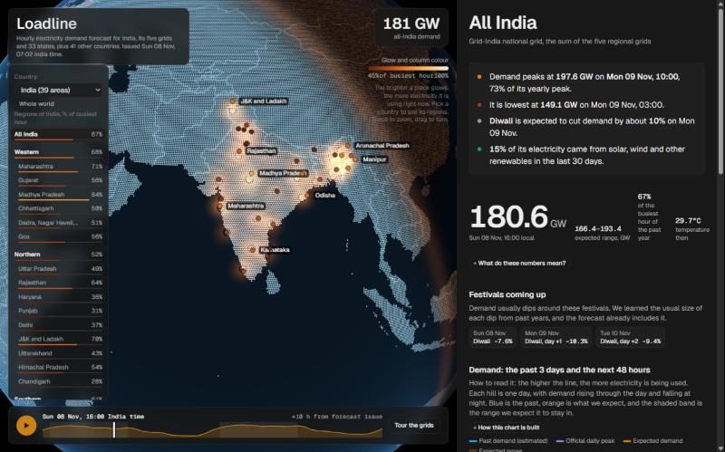
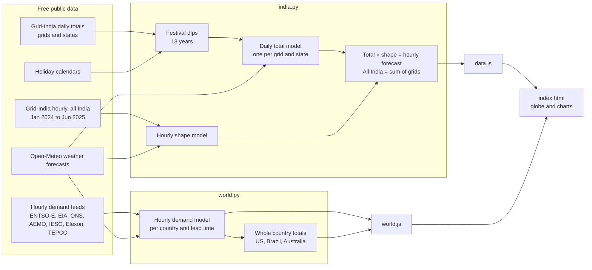
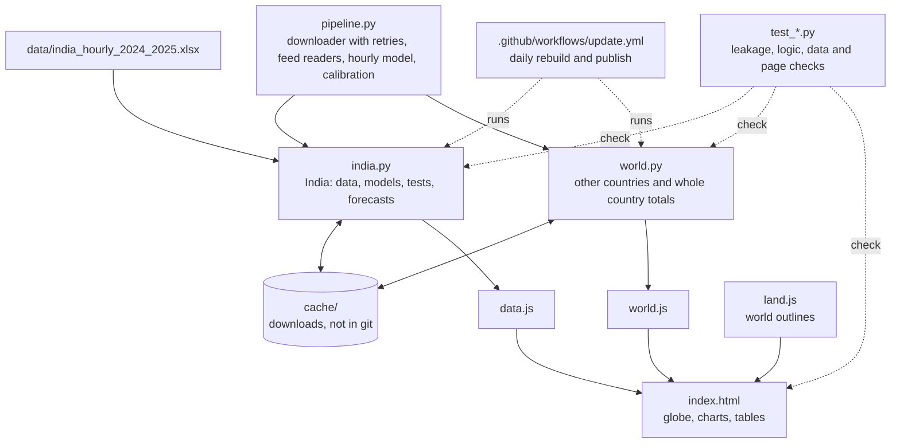

# Loadline

**Hour by hour electricity demand forecasts for India, its states and 41 other countries, on an interactive 3D globe.**



Loadline forecasts how much electricity a country or region will use over the next 48 hours, tests
those forecasts against past days they never saw, and shows where the electricity comes from. It is
the same job grid operators do every day, built entirely from free public data, with no API keys.

**Live site:** `https://<your-user>.github.io/<repo-name>/` (available once the daily workflow has run once, see [Daily updates](#daily-updates))

## Contents

- [Features](#features)
- [Quick start](#quick-start)
- [Daily updates](#daily-updates)
- [How it works](#how-it-works)
- [Results](#results)
- [Limitations](#limitations)
- [Project structure](#project-structure)
- [Methods, for data science readers](#methods-for-data-science-readers)
- [Data sources](#data-sources)
- [Extending the project](#extending-the-project)

## Features

- **Country first, then region.** The globe opens with one dot per country. Pick a country from the
  menu or by clicking its dot, and only that country's regions appear: India's 5 grids and 33
  states, the US's 11 grids, Brazil's 4 zones, Australia's 5 states.
- **A globe that glows with demand.** Each place lights up in proportion to how much electricity it
  is using now compared with its normal peak. The light follows the 48 hour forecast as you play it,
  and a day and night line sweeps across.
- **48 hour hourly forecast** with an expected range, for 42 countries and regions, plus whole
  country totals for the US, Brazil and Australia.
- **Honest accuracy.** Every forecast is tested on days it never saw and compared with a simple
  guess ("the same as this time last week"). The page states whether the model beats that guess.
- **Festival effects for India.** The usual dip around Diwali, Holi, Onam, Pongal and others, learned
  from 13 years of data and applied per state calendar.
- **Where the electricity comes from.** Generation by fuel for India and its five grids, with
  renewable share and unmet demand.
- **Written for everyone.** Plain language summaries and "how to read this" notes sit beside every
  chart. The technical charts live in a collapsed "For students" section.
- **Updates itself.** A GitHub Actions workflow rebuilds the forecasts every morning and publishes the site.

## Quick start

Requires [Python](https://www.python.org/downloads/) 3.10 or newer.

```bash
pip install -r requirements.txt
```

Refresh the India forecasts (about 5 minutes, then cached):

```bash
python india.py
```

Refresh the other countries (about an hour the first time, downloading roughly 200 MB that is then cached):

```bash
python world.py
```

View the site at <http://localhost:8765>:

```bash
python -m http.server 8765
```

Run the tests:

```bash
pytest
```

## Daily updates

`.github/workflows/update.yml` rebuilds every forecast each morning (03:30 UTC, 09:00 in India) and
publishes the site with GitHub Pages. After pushing the project to GitHub:

1. Open **Settings, then Pages**, and set the source to **GitHub Actions**.
2. Optional: add a repository secret named `EIA_API_KEY` (a free key from
   <https://www.eia.gov/opendata/>) under **Settings, Secrets and variables, Actions**. Without it
   the US data may be rate limited.
3. Open the **Actions** tab, choose **Update forecasts and publish**, and press **Run workflow**.
   The first build takes an hour or two. Later ones are faster because downloads are cached.

Before publishing, the workflow runs the test suite and checks that the new forecasts are complete,
so a broken download never replaces a good page. For a public repository the Actions minutes and
Pages hosting are free.

## How it works

India publishes electricity use for each grid and state every day, up to yesterday, but no free live
hourly feed. Most other countries do publish hourly demand. Loadline therefore uses two routes.

**India: daily level multiplied by hourly shape.**

1. A model forecasts each grid's and state's *daily total* from recent days, the calendar, holidays,
   festivals and the weather forecast.
2. A second model, trained on an older hourly record for all of India, learns the *shape* of a day
   (the morning peak, the overnight low), and that shape is rescaled to each grid's usual peak.
3. Multiplying the two gives hourly demand. All India is the sum of the five grids.

**Other countries: a direct hourly model** on the latest hourly demand readings, the calendar and
the weather, with a separate model for each lead time.



Every model is scored with **walk forward backtests**: refit on earlier data only, forecast the next
30 days, move on. The expected range (the shaded band) is calibrated on separate data so its stated
80% goal is measured honestly. See [Methods](#methods-for-data-science-readers).

## Results

Average error as a percentage of real demand, forecasting ahead on days the model had not seen.
Lower is better. "Last week" is the simple guess a useful forecast must beat.

<!-- results:start -->

### India

| Area | Test | Loadline | Last week |
|---|---|---|---|
| All India | Every hour, 25 Mar to 24 Jun 2025 | **3.5%** | 5.7% |
| All India | Daily energy, 09 Aug to 06 Nov 2026 | **2.0%** | 3.3% |
| All India | Daily peak, 09 Aug to 06 Nov 2026 | **3.7%** | 4.0% |
| Five grids | Daily total, last 90 days | **3.1% to 4.5%** | 4.3% to 7.2% |
| Five grids | Daily peak, last 90 days | **4.1% to 6.4%** | 5.3% to 6.5% |
| 33 states | Daily total, last 90 days | **2.6% to 10.9%** | 3.6% to 18.5% |

Loadline beats the simple guess in 33 of 33 states and in 5 of 5 grids on daily totals. On daily peaks it beats the guess in 4 of 5 grids.

### Other countries

Hourly error over the last 90 days across **58 areas in 41 countries**: 1.8% to 17.2%, typically 3.9%. Loadline beats the simple guess in **58 of 58**. Best: Norway (1.8%). Weakest: Bosnia and Herzegovina (17.2%).

| Whole country | Loadline | Last week | Grid operators' own forecast |
|---|---|---|---|
| Australia (main grid) | **2.9%** | 5.0% | not published |
| Brazil (whole country) | **2.5%** | 4.3% | not published |
| United States (all 11 grids) | **2.6%** | 4.7% | 1.0% |

**United States, grid by grid.** Grid operators have live data and publish their own forecasts.

| Grid | Loadline | Last week | Operator |
|---|---|---|---|
| California | **6.4%** | 12.6% | 8.2% |
| Florida (US) | 5.0% | 8.2% | 2.9% |
| Mid-Atlantic US | 3.8% | 7.4% | 3.5% |
| New England | 5.5% | 10.1% | 3.1% |
| New York | 4.3% | 8.7% | 2.6% |
| Pacific Northwest (US) | 2.2% | 4.1% | 1.5% |
| Southern Company (US) | 4.0% | 8.9% | 1.5% |
| Southwest Power Pool (US) | **3.9%** | 7.9% | 6.5% |
| Tennessee Valley (US) | 4.5% | 10.4% | 2.2% |
| Texas | 3.4% | 6.6% | 1.4% |
| US Midwest | 3.0% | 6.3% | 2.1% |

Loadline beat the operator in 2 of 11 grids (California, Southwest Power Pool (US)); bold marks those.

### Expected ranges

The shaded band is built to hold the real value 80% of the time. Measured on the most recent third of the test period, which the band was not fitted to:

| Group | Median share of times the real value fell inside the band | Goal |
|---|---|---|
| All India (hours) | 83.8% | 80% |
| Five grids (daily peaks) | 63.3% | 80% |
| 33 states (daily totals) | 80.0% | 80% |
| 58 other areas (hours) | 82.0% | 80% |

These fall short of 80% in places because errors can grow faster than past errors suggest.

<!-- results:end -->

## Limitations

- **India's hourly accuracy is only proven on older data.** The free hourly record ends in June 2025,
  so recent months are checked on daily totals and daily peaks.
- **Regional and state hours in India are estimates.** No free regional or state hourly data exists,
  so they follow the national daily shape rescaled to each grid's usual peak. States publish no
  peaks at all, so their "% of busiest hour" is estimated.
- **Grid operators beat Loadline in most of the US.** Operators have live data. Loadline beat the
  operator's own forecast in only two of 11 US grids, and the 11 grids added together are forecast
  far better by the operators than by Loadline.
- **Expected ranges are calibrated, not perfect.** They are tuned to hold the real value 80% of the
  time on earlier data, but errors can grow faster than the past suggests, so some areas fall short.
- **Some small countries have noisy data**, such as Bosnia and Herzegovina, North Macedonia, Moldova
  and Montenegro. Their forecasts are much less accurate than their neighbours'.
- **Outside India there is demand only**: no festival adjustment and no generation by fuel.
- **Whole country totals are partial for the US and Australia.** The US total covers 11 grids, and
  Australia's covers the five states of its main grid. Japan and Canada show only Tokyo and Ontario,
  the only parts with free hourly data.
- **India's states do not sum to their grid**, because DVC, the railways and large industrial buyers
  are reported separately. State weather comes from one city, its main load centre.
- **Import and export positions are approximate.** Generation is measured before plants' own use and
  line losses, and consumption after (nationally about 7 to 9% apart).
- **No free data exists for most of Africa, the Middle East and Asia**, so those are missing.
- **Map borders** come from Natural Earth and may differ from India's official map in disputed areas.

## Project structure



| Path | Purpose |
|---|---|
| [`india.py`](india.py) | India pipeline: loads data, learns festival effects, trains the daily level and hourly shape models, backtests, builds grid, state and supply views, writes `data.js`. |
| [`world.py`](world.py) | Forecasts for every other country with a free hourly feed, plus whole country totals. Writes `world.js`. |
| [`pipeline.py`](pipeline.py) | Shared code: cached downloader with retries, feed readers for each source, the hourly demand model, and range calibration. |
| [`index.html`](index.html) | The whole front end: a three.js globe with a custom shader, a 48 hour timeline and hand drawn SVG charts. No framework or build step. |
| [`data.js`](data.js), [`world.js`](world.js) | Generated forecasts and results. Recreated whenever the pipelines run. |
| [`land.js`](land.js) | World country outlines used to draw the globe. |
| [`data/`](data) | The hourly all India record the daily shape is learned from. |
| `test_*.py` | Automated tests (see below). |
| [`.github/workflows/update.yml`](.github/workflows/update.yml) | The daily rebuild and publish job. |

**Tests** (`pytest`) check that no future data leaks into the model inputs, that festival effects are
learned only from earlier data, that regional shapes keep timing and daily totals, that the
calibrated ranges behave, that every generated area has everything the page reads (complete,
ordered forecasts, unique ids, believable accuracy), and that the page script parses.

## Methods, for data science readers

| Technique | How it is used | Where |
|---|---|---|
| Short term load forecasting | Hourly demand, 48 hours ahead | whole project |
| Temporal disaggregation | Forecast a daily total, split it into hours with a learned shape | `india.py`: `combine`, `shape_of` |
| Hierarchical forecasting | All India as the sum of five grids beat a direct national model (2.35% vs 2.51% daily error) | `india.py`: `forecast_sum` |
| Data alignment | Joining sources with different units and time zones (India is UTC+5:30, so its hours fall on :30 UTC) | `india.py`: `load_daily`, `weather` |
| Feature engineering | Calendar and holidays, cooling and heating need from temperature, recent demand as a ratio to last week's level | `daily_features`, `shape_features`, `pipeline.features` |
| Honest weather inputs | Weather as it was forecast a day earlier, never as it turned out | `weather` |
| Gradient boosted trees | LightGBM predicting log(demand ÷ recent level), so fast growth does not break the model | `fit_daily`, `fit_shape`, `pipeline.fit` |
| Direct multi horizon models | A separate model for each lead time, each using only data available then | `daily_forecast`, `pipeline.build` |
| Event effect estimation | Festival dips as robust medians against the same weekday nearby, over up to 8 years; only dips that recur are kept; removed before training and added back after | `festival_table`, `festival_effect` |
| Walk forward backtesting | Refit on earlier data, forecast the next 30 days, repeat | `blocks`, `main`, `pipeline.build` |
| Baseline comparison | Every model must beat "same time last week", and US areas are also compared with the grid operator's own forecast | `main`, `world.py` |
| Calibrated prediction intervals | Band edges from the first third of the errors, a widening factor fitted on the second third, coverage reported on the last third | `pipeline.calibrate` |
| Leakage tests | Unit tests change future values and confirm the inputs do not move | `test_india.py`, `test_pipeline.py` |

Not used: deep learning, automatic hyperparameter search, ensembles. Some rules (which festival dips
to keep, the 60 day peak window) were chosen after seeing test results, so those results may be
slightly optimistic.

## Data sources

| Data | Source |
|---|---|
| India daily demand and generation by fuel, grids and states | Grid-India daily reports, compiled by [Robbie Andrew](https://robbieandrew.github.io/india/) |
| India hourly demand, 2024 to 2025 | Grid-India data via [Mendeley Data](https://data.mendeley.com/datasets/y58jknpgs8) |
| Hourly demand, European countries | [Energy-Charts](https://energy-charts.info) (Fraunhofer ISE), built on ENTSO-E data |
| Hourly demand, United States | [US EIA Hourly Grid Monitor](https://www.eia.gov/electricity/gridmonitor/) |
| Hourly demand, other countries | IESO (Ontario), ONS (Brazil), Elexon (Great Britain), AEMO (Australia), TEPCO (Tokyo) |
| Weather forecasts | [Open-Meteo](https://open-meteo.com) (free for non commercial use) |
| Holidays and festivals | the [`holidays`](https://pypi.org/project/holidays/) Python package |
| World map outlines | Natural Earth via `world-atlas` |

Check each source's licence and terms before reusing the data elsewhere, in particular Open-Meteo's
non commercial limit.

**Design:** the page's visual system (type scale, spacing, corner radii, motion) follows part B of
[elayadesign/ai-design-skills](https://github.com/elayadesign/ai-design-skills) (MIT).

## Extending the project

**Add a country.** In `world.py`, add an entry to `EXTRA` with its code, name, operator, ISO country
code, time zone and a few cities for weather. European countries covered by Energy-Charts take one
line using the `eu(...)` helper. A country that lacks a free hourly feed needs a reader in
`pipeline.py` that returns an hourly demand series (and, optionally, the operator's own forecast).

**Add a region to a country that already has several.** Add its entry to `EXTRA`, and add its id to
that country's `whole(...)` call if it should count towards the country total.

Run `python world.py <ID>` to rebuild a single area without redoing the rest.
